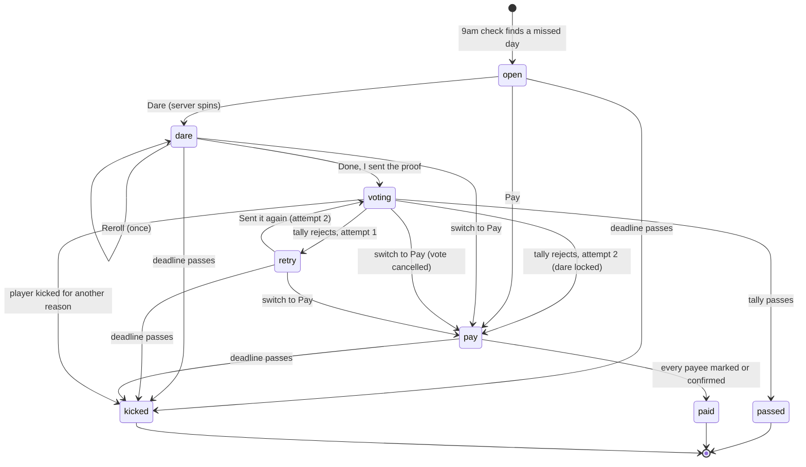

# Pay or Dare + eliminations: spec

Status: **approved 22 Nov 2026**, including items 1–17 below. Being built on `pay-or-dare`.
Branch: `pay-or-dare` (from `main`). Last updated 22 Nov 2026.

cTicks never touches money or media. Payments happen on UPI, dare proof goes to the group chat (WhatsApp, Instagram). cTicks tracks penalties, dares, votes and eliminations, and nothing else. No uploads, no Firebase Storage, still the free Spark plan.

---

## 0. Read this first: where I changed your defaults

Your rules are in section 2 as written, except for the points below. Each one either contradicts another rule, opens a loophole, or doesn't fit how the app runs. **Say "keep mine" on any number and I'll use your original.**

**Rules that don't hold up as written**

| # | Your rule | Problem | What the spec does instead |
|---|---|---|---|
| 1 | Penalty not *resolved* within 48h → kicked | A dare done at hour 47 still needs a 24h vote, and a payment marked at hour 47 needs up to 48h to be confirmed. Both would get kicked while waiting on someone else. | The 48h is to **act**: mark "I paid" or tap "Done, I sent the proof". Once you've acted, the clock stops. Votes and confirmations run on their own windows. |
| 2 | Dare rejected twice → kicked | Contradicts "paying is always available, nobody is forced into a dare". In a 2-person group the only voter could reject twice and knock their friend out to win the round. | A second rejection **locks the dare and makes you pay** (at least 24h to mark paid). You're kicked only if you then don't. The worst a hostile voter can do is make you pay the stake, which is the normal penalty anyway. |
| 3 | Majority of votes cast; tie passes; no votes passes | With 3+ people, one ❌ while everyone else ignores the vote fails the dare (1 of 1 votes cast). | Rejected only when **more than half of all eligible voters** vote ❌. Not voting counts as ✅. Ties and no votes still pass. In a 2-person group this is identical to your rule. |
| 4 | Unpaid amounts of a kicked player "stay visible" | If an unresolved penalty owes nothing, getting kicked is cheaper than paying: miss, ignore it, get kicked, owe nothing. | Any penalty that ends because the player was kicked **still counts as the stake owed** to each payee, shown as unpaid. A passed dare is the only way a miss costs nothing. |
| 5 | PAY = owe the stake to each member "as now" | Today misses **net out** per pair and you settle once at the end ("misses cancel out" on the landing page). Paying each penalty within 48h can't net out: two friends would just send ₹100 back and forth. | In Pay or Dare mode each PAY penalty is paid on its own, to each other member, with no netting. Money only mode keeps netting and end-of-round settling exactly as now. The landing story's last beat ("misses cancel out") gets rewritten, since it would be false for the new default. |
| 6 | "I paid", payee taps "Got it", silence = auto-confirm | Money moves outside the app, so "I paid" plus 48h of silence counts as paid even if nothing arrived. There's also no way to confirm a payment from a payee who's been kicked (kicked players lose access to the group). | Payees get **"Got it"** and **"Didn't get it"**. "Didn't get it" flips that payment back to unpaid and pings the payer. It never causes a kick, because the player already acted. Payees can confirm even if the payer never tapped "I paid". A kicked payee's payments confirm automatically. |
| 7 | Push: "Aryaan says **he** did **his** dare" | The app doesn't know anyone's gender, and a wrong pronoun lands on a real friend. | All push and in-app text avoids gendered pronouns: "Aryaan says the dare is done". The landing story's fictional characters keep their copy. |

**Decisions I made where the brief was open**

| # | Decision | Why |
|---|---|---|
| 8 | **Every deadline is 9:00am IST**, the moment the morning check runs. Decide by 9am two mornings after the penalty arrives (48h). Vote and retry windows end at the first 9am at least 24h away (24 to 48h). Unconfirmed payments auto-confirm at the first 9am at least 48h after "I paid". | Vercel's free cron runs once a day. If deadlines fell at random times, the time shown wouldn't be the time it's enforced. With 9am deadlines, "checked every morning at 9" is exactly true. The server also refuses any action after its deadline, even before the check runs. |
| 9 | **Pay is available from every unfinished state until the deadline**, including during a vote (switching cancels the vote). If less than 24h is left, or the deadline has passed while you were in a vote, switching gives you until the next 9am at least 24h away. | Makes "paying is always available" literally true. |
| 10 | **3 in a row** = 3 consecutive calendar days (IST), each a counted round day for that player, each a miss. It carries over a round boundary only if the next round started the very next day. A day between rounds breaks it. | The most literal reading of "in a row", and testable. Counted from penalty records, so it works across rounds. |
| 11 | **A kick never empties a group.** If everyone left would be kicked in the same check, nobody is removed and the round ends with no winner. | A group with 0 members can't be read or restarted by anyone, and kicked players can only rejoin once a new round starts. It would be dead forever. |
| 12 | **Voters are fixed when "Done" is tapped** (the members at that moment, minus the player). People who join later don't vote, and a voter who gets kicked stops counting. **Payees are fixed when the penalty is created.** | Someone who joined after the proof was sent probably never saw it, and the debt belongs to the people who were in the group on the missed day. |
| 13 | **In Pay or Dare mode, stake and miss-rule changes apply from the next round**, like the mode itself. Money only keeps today's "re-scores the whole round". | Penalties already created have fixed amounts and may already be paid or dared. Re-scoring them makes no sense. |
| 14 | **Starting a round moves to the server** (`/api/group`). | It has to create the outgoing round's last penalties, apply queued settings and send the final push in one go. Otherwise "start a new round before 9am" dodges yesterday's penalties, and today that same move already loses the round-over push. |
| 15 | **Rejoining after a kick goes through the server** (`/api/group`, action `rejoin`), and the rules block the client join path for anyone currently out. | The player's old doc keeps their original `joined` date. Rejoining client-side would count the new round's earlier days as misses and create penalties for days they weren't in. Your rules test "kicked user can rejoin next round" becomes a logic + API test; the rules test checks the client path is closed. |
| 16 | **Votes are stored per attempt:** `votes/{attempt}_{voterUid}` instead of `votes/{voterUid}`. | A retry needs a fresh vote from everyone. |
| 17 | The group sees the dare when it's spun, and **again only if the player rerolls** (2 pushes at most per dare). | You asked for a spin push. Holding it back until after the reroll would add a "lock it in" step. |

---

## 1. Setup needed before Step 2 (things only you can approve or do)

1. **Preview deploys have no Firebase config.** All 8 env vars are set for Production only (`vercel env ls`). For an end-to-end test on a preview I need to add the same values to the **Preview** environment, read from `.env.local` and piped to `vercel env add`, never printed.
2. **Firebase Auth → Authorized domains** needs the preview's branch domain (`cticks-git-pay-or-dare-faizjamal06s-projects.vercel.app`), or sign-in fails there. `cticks.vercel.app` is still waiting to be added too, so sign-in on the new production domain doesn't work yet.
3. **Previews share the production Firebase project** (there's only one, `payup-c1ee8`). So:
   - End-to-end tests use their own test groups and test accounts, deleted afterwards.
   - The cron routes get a `?gid=` parameter, accepted only with `CRON_SECRET`, so test calls never touch your real group.
   - Deploying rules changes production immediately, so rules ship in two phases (section 7.3).
4. **Vercel Deployment Protection** blocks automated browsers from the preview (302 to Vercel sign-in). For the end-to-end run and the screenshots I need a **Protection Bypass for Automation** secret. I can create it through the Vercel API if you OK it. It only affects preview URLs.
5. **`polish-landing` is still unmerged.** The landing copy for this feature is written against whichever landing version is on `main` when I build it.

---

## 2. The rules

### 2.1 Penalty mode

- Each group has `penaltyMode`: **Money only** (`money`, today's behaviour) or **Pay or Dare** (`dare`).
- New groups default to **Pay or Dare**. Existing groups have no field, which means Money only, until a member switches it.
- Any member can switch. **The switch takes effect when the next round starts, never mid-round.** The same goes for stake and miss-rule changes in Pay or Dare mode (#13).
- Eliminations exist only in Pay or Dare mode. Money only works exactly as today: no penalties, no kicks, ledger nets out per pair.

### 2.2 Penalties

- Every counted missed day in a Pay or Dare round creates one **penalty** for that player. A missed day is counted exactly as today (`countedDays` + `isMiss`).
- Penalties are only created when the group has 2 or more members. With nobody to pay, there's no penalty.
- Penalties are created by the **9am check** the morning after the miss. The id is `{uid}_{day}`, so creating one twice is impossible.
- Each penalty snapshots `stake` (the amount per payee) and `payees` (every other member at that moment).
- The player has until **9:00am IST two mornings later** (48h) to **act** (#1, #8):
  - **Pay:** choose Pay and tap "I paid" (or have every payee confirm).
  - **Dare:** choose Dare, do it, and tap "Done, I sent the proof".
- Not acting by then gets you **kicked** at that check.
- Several penalties can be open at once (one per missed day). Each runs independently.

### 2.3 Pay

- Choosing Pay shows the amount per payee and a payee list. The player pays each person outside the app (UPI), then taps **"I paid"**, which marks every unpaid payee.
- Each payee then sees **"Got it"** or **"Didn't get it"** (#6).
  - "Got it" → that payment is confirmed.
  - "Didn't get it" → back to unpaid, and the payer gets a push. It never causes a kick, and no deadline restarts (the penalty stays `paid`; the payer can mark it again any time).
  - No answer → auto-confirms at the first 9am at least 48h after "I paid".
  - A payee can tap "Got it" even if the payer never tapped "I paid".
  - A payee who's been kicked → their payments confirm automatically.
- Once every payee is marked or confirmed, the penalty is **paid**: the player has acted and can't be kicked for it. The money card keeps showing anything not yet confirmed.
- **Paying is always available** until the deadline, from every unfinished state, including after a rejection and during a vote (#9).

### 2.4 Dares and the deck

- **Deck = starter dares (in code, Appendix A) + approved custom dares, minus reported ones.**
- **Custom dares:**
  - Any member can add one, up to 120 characters. The dare rules are shown above the input.
  - The server runs a blocklist check (section 8.3). A blocked dare is refused, and the message names the rule it broke.
  - A new dare is **pending** until one member who isn't its author approves it.
- **Reporting:** any member can report any dare, starter or custom, with an optional reason. It leaves the deck at once. It returns only when someone other than the reporter (and, for custom dares, not the author) re-approves it.
- **The dare rules** (shown when adding, and on the deck screen). A dare must NOT involve:
  - risk of injury: fire, heights, sharp or hot objects, choking, extreme cold or heat, eating non-food, eating extreme amounts or extreme spice
  - alcohol or drugs
  - vehicles
  - anything illegal
  - nudity or sexual content
  - strangers, or pranks on people who didn't agree
  - damaging property
  - posting the video publicly (proof goes to your group only)

  Plus: it should be doable at home in about 30 seconds.
- **The spin:**
  - Choosing Dare asks the server for a random dare from the deck (`crypto.randomInt`). It prefers dares this player hasn't had this round.
  - The client then plays a spin animation that lands on the server's pick. The animation is decoration; the result was already decided.
  - **1 reroll**, which always gives a different dare.
  - If the deck is empty (everything reported), Dare is unavailable and the card says why. Pay is still there.

### 2.5 Proof and voting

- **After the spin**, the player sees the dare and a **Share dare** button (`navigator.share`, falling back to copy). It prefills: "My cTicks dare: <dare>. Proof coming on WhatsApp. Vote in the app: https://cticks.vercel.app/app"
- **Done:** the player does the dare, sends the video or photo to the group chat, then taps **"Done, I sent the proof"**. That:
  - opens voting at once,
  - fixes the voter list (#12),
  - sets the window to close at the first 9am at least 24h away.
- **Voting:**
  - Every voter votes ✅ Done or ❌ Not done. ❌ needs a reason: "Didn't get any proof", "Didn't actually do it", "Did a different or easier version", or "Other" (up to 80 characters).
  - Votes show with names. You can change your vote until the vote closes.
  - The player can't vote on their own penalty.
- **The tally (#3)** runs the moment every eligible voter has voted, or at the 9am check after the window closes:
  - **Rejected** if ❌ votes > half of the eligible voters.
  - **Passed** otherwise. That includes ties, and no votes at all.
  - If every eligible voter has gone (kicked), it passes at once.
- **First rejection** → **retry**: the player can tap **"Sent it again"** (same dare, re-send the proof) by the first 9am at least 24h away. That opens a fresh vote, attempt 2. Or they can switch to Pay. Doing neither gets them kicked at that check.
- **Second rejection** → **must pay (#2)**: the dare is locked, and the player has until the first 9am at least 24h away to mark paid. If they don't, they're kicked at that check.
- **A passed dare owes nothing.**

### 2.6 Eliminations (Pay or Dare mode only)

**A player is kicked when:**
1. a penalty's deadline passes without them acting (not chosen, dare not done, retry not sent, or must-pay not marked),
2. they've missed **3 days in a row** (#10), whether or not those penalties are resolved. The morning after the 2nd miss in a row, their penalty push carries the warning "One more miss and you're out", and that evening's 9pm reminder says "Miss today and you're out".

All kicks happen at the 9am check. Thanks to #2, no vote result ever kicks anyone directly.

**What a kick does:**
- Removes the player from `members` and records `kicked[uid] = { round, day, why, owed }`.
- Closes their unfinished penalties as `kicked`. Those still count as owed (#4).
- Leaves their `paid` penalties alone; payees can still confirm.
- Stops their pending votes counting. Any vote that was only waiting on them is tallied at once.
- Confirms any payments owed to them that were marked.
- Sends a push to everyone, including them.

**After a kick:**
- The player keeps their account.
- The app shows them a "You're out" screen with the reason, what they owed when they were removed, and when they can rejoin.
- They **can't rejoin until the group's next round starts**. Then "Rejoin" puts them back with `joined` = today (#15).
- What they owe stays visible to the group in the money card and in penalty history.
- **If a kick leaves 1 member**, the round ends (its last day becomes yesterday) and that person wins. **If it would leave 0**, nobody is removed and the round ends with no winner (#11).

### 2.7 Rounds

- **Penalties outlive their round.** A new round never cancels, voids or speeds up an open penalty. Resolution and kicks still run.
- **Starting a round** (server, #14), in order:
  1. Create any missing penalties for the outgoing round's finished days.
  2. Send the round-over push if it hadn't gone out.
  3. Apply queued `next` settings (mode, and in Pay or Dare mode, stake and rule).
  4. Clear `endedEarly`.
  5. Bump `round`.

  Players out from an earlier round can now rejoin.
- A **mid-round restart** abandons the current day, as today. Days already missed keep their penalties.
- **Round over** in Pay or Dare mode: the push lists what's still unpaid instead of a net settle-up.

---

## 3. Penalty state machine



Every penalty has exactly one `due` timestamp: the deadline the next 9am check acts on. `null` once nothing more can time out.

| From | Event | Who / what | Guard | To | Side effects |
|---|---|---|---|---|---|
| none | missed day found | 9am check (or round start) | Pay or Dare round, 2+ members, no penalty for `{uid}_{day}` yet | `open`, due = actBy | Push to player (+ 2-in-a-row warning), push + feed to group |
| `open` | Pay | player | now < due | `pay`, due unchanged | Feed |
| `open` | Dare | player | now < due, deck not empty | `dare`, dare picked, rerollsLeft 1 | Push to group "Aryaan's dare: …", feed |
| `dare` | Reroll | player | rerollsLeft 1, now < due | `dare`, new dare ≠ old, rerollsLeft 0 | Push to group "Aryaan rerolled: …" |
| `dare` | Done | player | now < due | `voting`, attempt 1, voters fixed, voteEnds set, due = voteEnds | Push to voters. No voters → tally at once |
| `voting` | vote | voter | voter in voters and still a member, now < voteEnds | `voting` (vote saved) | Tally if every eligible voter has voted |
| `voting` | tally passes | last vote, 9am check, or eligible voters shrinking | ❌ ≤ half of eligible | `passed`, due null | Push to everyone, feed |
| `voting` | tally rejects, attempt 1 | same | ❌ > half of eligible | `retry`, due = retryBy | Push to player (retry or pay), push + feed to group |
| `retry` | Sent it again | player | now < due | `voting`, attempt 2, voters re-fixed, new voteEnds | Push to voters |
| `voting` | tally rejects, attempt 2 | same | ❌ > half of eligible | `pay`, locked, due = first 9am ≥ 24h | Push to player "pay or you're out", feed |
| `open` / `dare` / `voting` / `retry` | switch to Pay | player | now < due (for `voting`: any time before the tally) | `pay`, due = current due, or the first 9am ≥ 24h if less is left | Votes cancelled (kept, but not counted), feed |
| `pay` | I paid | player | now < due | marks every `owed` payee; if all marked or confirmed → `paid`, due null | Push to payees "Confirm you got it" |
| `pay` / `paid` | Got it | payee | payee in payees, member | that payment → confirmed; `pay` → `paid` if now all done | Push to payer |
| `paid` | Didn't get it | payee | that payment is marked | that payment → owed (status stays `paid`) | Push to payer |
| `paid` | auto-confirm | 9am check | payment marked and now ≥ confirmBy | that payment → confirmed | none |
| `open` / `dare` / `retry` / `pay` | deadline passes | 9am check | now ≥ due | `kicked` | Kick the player (2.6) |
| any unfinished | player kicked for another reason | 9am check | n/a | `kicked` | none extra (the kick push covers it) |

**Illegal events** return an error and change nothing: wrong person, wrong status, after the deadline. **Repeats are no-ops:** a second "Done", "I paid" or identical vote returns the current state. Each action runs in a Firestore transaction that re-reads the penalty and checks the guard, so two devices or a double tap can't apply anything twice, and a push only goes out when a transition actually happened.

**Per-payee payment sub-states:** `owed` → `marked` (payer) → `confirmed` (payee, auto, or kicked payee). `owed` → `confirmed` (payee directly). `marked` → `owed` ("Didn't get it").

---

## 4. Data model

```
groups/{CODE}                       (new fields; everything else as today)
  penaltyMode?: "money" | "dare"    missing = "money". Server-only after creation.
  next?: { penaltyMode?, stake?, rule? }   queued for the next round. Members write it (validated).
  kicked?: { [uid]: { round, day, why: "timeout" | "streak" | "unpaid", owed } }
                                     currently out. Server-only. An entry is removed on rejoin.
  endedEarly?: "YYYY-MM-DD"         last day of a round that ended by elimination. Server-only.
  winner?: uid                      set when a round ends with one member left. Server-only.

groups/{CODE}/penalties/{uid}_{day} server-only writes, members read
  uid, day, round, createdAt
  stake: number                     per payee, snapshot
  payees: uid[]                     snapshot at creation
  status: "open" | "dare" | "voting" | "retry" | "pay" | "paid" | "passed" | "kicked"
  due: ms | null                    the one deadline the next check acts on
  actBy: ms                         9:00 IST, two days after the creation day
  locked: boolean                   true after a second rejection (dare no longer allowed)
  dare: { id, text } | null
  rerollsLeft: 0 | 1
  attempt: 0 | 1 | 2
  doneAt: ms | null                 last "Done" / "Sent it again"
  voters: uid[]                     fixed at Done
  voteEnds: ms | null
  tallies: [{ attempt, done, notDone, eligible, outcome, at }]
  payments: { [payeeUid]: { s: "owed" | "marked" | "confirmed", at: ms, confirmBy?: ms, how?: "payee" | "auto" | "kicked" } }
  closedAt?: ms, closedWhy?: string
  updatedAt: ms

groups/{CODE}/penalties/{id}/votes/{attempt}_{voterUid}   server-only writes, members read
  voter, attempt, vote: "done" | "not", reason?: "noproof" | "notdone" | "easier" | "other", note?: string (≤ 80), ts

groups/{CODE}/dares/{id}            server-only writes, members read
  text (≤ 120), by: uid | "cticks", createdAt
  approvedBy: uid | null            null = pending
  active: boolean
  reported: { by, at, reason? } | null
  (starter dares live in code with ids s01–s25. A doc with a starter's id only exists once someone reports it.)

groups/{CODE}/feed/{id}             new server-written kinds, written with pushed: true
  penalty | choice | spin | done | result | again | paid | confirm | dispute | kicked | ended | dare-added | mode
```

No migration: existing groups read as Money only, and nothing new is created for them until someone switches the mode and a new round starts.

---

## 5. Server

All new writes go through Next.js API routes that verify the Firebase ID token with the admin SDK, exactly like `/api/notify`. Each route:
1. checks membership (the right role for the action),
2. runs one Firestore transaction (re-read, check the guard with the pure reducer from section 8, write),
3. then sends pushes and writes feed items only if a transition happened.

| Route | Who | Actions |
|---|---|---|
| `POST /api/penalty` `{ gid, id, action, … }` | the player | `pay`, `dare`, `reroll`, `paid`, `done`, `again` |
| | a voter | `vote` `{ vote, reason?, note? }` |
| | a payee | `got`, `notgot` |
| `POST /api/dares` `{ gid, action, … }` | members | `add` `{ text }`, `approve` `{ id }`, `report` `{ id, reason? }` |
| `POST /api/group` `{ gid, action, … }` | members | `start` `{ days, when }` (replaces today's client write, #14) |
| | someone out | `rejoin` (only if `kicked[uid].round < round`, a free slot exists, and they're signed in; resets `joined` to today) |
| `GET /api/cron/results` | Vercel Cron, 03:30 UTC (9:00 IST) | Money only groups: unchanged. Pay or Dare groups: the 9am check below. `?gid=CODE` (with `CRON_SECRET`) limits the run to one group, for tests. |
| `GET /api/cron/reminder` | Vercel Cron, 15:30 UTC | Copy changes only: Pay or Dare wording, and "Miss today and you're out" for anyone on 2 in a row. Also accepts `?gid=`. |

**The 9am check, per Pay or Dare group, in this order:**
1. Tally every `voting` penalty whose window has closed.
2. Auto-confirm marked payments past `confirmBy`.
3. Create penalties for counted missed days that don't have one: yesterday, plus the 3 days before as catch-up in case a cron run was skipped.
4. Find players with 3 misses in a row → kick.
5. Find penalties with `due ≤ now` in `open` / `dare` / `retry` / `pay` → kick their player.
6. Apply all kicks together:
   - Remove members, unless that would leave 0 (#11).
   - Re-tally votes that lost their last pending voter.
   - Confirm payments owed to kicked payees.
   - End the round if 1 member is left.
7. Send pushes: one per person per event type, merged where possible. Write the feed items.

Every step is idempotent, so a cron run that fires twice, or a test run, can't double anything.

**Deadline helper:** `nineAm(day)` is 09:00 IST on that day. `nextNine(ms, hours)` is the earliest `nineAm(d)` that is ≥ ms + hours.
- `actBy = nineAm(createdDay + 2)`
- `voteEnds = retryBy = nextNine(doneAt or rejectedAt, 24)`
- `confirmBy = nextNine(markedAt, 48)`

---

## 6. Notifications

Server-written text in Tik's voice, no gendered pronouns (#7). Every event also gets a feed line. `₹100` stands for the stake and `Sat` for the deadline's day.

| Event | To | Title | Body |
|---|---|---|---|
| Penalty created | player | 💸 You missed yesterday | Pay ₹100 or take a dare. Decide by 9am Sat. |
| …2 in a row | player | 💸 That's 2 in a row | Pay ₹100 or take a dare by 9am Sat. One more miss and you're out. |
| Penalty created | others | 💸 Aryaan missed yesterday | Pay or dare, their call. If it's a dare, you'll get a vote. |
| Dare spun | others | 🎲 Aryaan's dare | <dare> |
| Rerolled | others | 🎲 Aryaan rerolled | New dare: <dare> |
| Done tapped | voters | 🎭 Aryaan says the dare is done | <dare>. Check WhatsApp and vote by 9am Sat. |
| Sent it again | voters | 🎭 Aryaan sent the proof again | <dare>. Vote by 9am Sat. |
| Passed | everyone | ✅ Aryaan's dare passed | 2 of 2 said done. Nothing owed. |
| Rejected, attempt 1 | player | ❌ Your dare didn't pass | Send the proof again or pay ₹100 by 9am Sat. |
| Rejected, attempt 1 | others | ❌ Aryaan's dare didn't pass | One retry left. |
| Rejected, attempt 2 | player | ❌ Second no | Pay ₹100 by 9am Sat or you're out. |
| Rejected, attempt 2 | others | ❌ Aryaan's dare failed twice | Now it's pay or out. |
| I paid | each payee | 💸 Aryaan says you've been paid ₹100 | Confirm you got it. No answer by 9am Sat counts as yes. |
| Got it | payer | ✅ Shanayaa got your ₹100 | That one's settled. |
| Didn't get it | payer | 🤨 Shanayaa says the ₹100 didn't arrive | Check your UPI and mark it paid again. |
| 9pm reminder, on 2 in a row | player | ⏰ Miss today and you're out | 2 left: Gym, Read. Finish before midnight. |
| Kicked | others | 🚪 Aryaan is out | <reason>. Back when round 2 starts. |
| Kicked | player | 🚪 You're out of round 1 | <reason>. You can rejoin when round 2 starts. |
| Round ended by elimination | everyone left + kicked | 🏁 Shanayaa is the last one standing | Round 1 is over. Start round 2 in the app. |
| Custom dare added | others | 🃏 New dare needs an OK | <dare> |
| Mode switched | others | Faiz switched to Pay or Dare | Starts with round 2. |

Kick reasons: "Ignored a penalty for 48h" · "Missed 3 days in a row" · "Didn't pay after a failed dare".

---

## 7. Firestore rules

### 7.1 New collections (all phases)

```
match /penalties/{pid} {
  allow read: if isMember(gid);
  allow write: if false;                 // server only (admin SDK)
  match /votes/{vid} { allow read: if isMember(gid); allow write: if false; }
}
match /dares/{did} { allow read: if isMember(gid); allow write: if false; }
```

### 7.2 Group doc

- **create:** `penaltyMode` is optional and must be `money` or `dare`. No `kicked`, `endedEarly`, `winner` or `next` on create.
- **member update:**
  - may never touch `kicked`, `penaltyMode`, `endedEarly` or `winner`,
  - `next` must be valid (mode in the list, stake 1 to 1,00,000, rule `all` or `none`),
  - members still can't add or remove anyone (unchanged).
- **join (client path):** as today, plus `!(me() in resource.data.get('kicked', {}))`. Someone who's out must use `/api/group rejoin` (#15).
- **players, feed:** unchanged. A kicked player isn't a member, so they lose read and write access to the group's players, feed, penalties, votes and dares. The group doc itself stays readable by code (it already is), which is how the "You're out" screen works.

### 7.3 Two phases (the preview shares production's Firebase)

- **Phase A**, deployed before the preview end-to-end test. Purely additive, so today's production app keeps working:
  - the new collections,
  - the server-only fields,
  - `next`,
  - the kicked join check.

  The old client round-start write (`start`, `days`, `round`) stays allowed.
- **Phase B**, deployed right after the merge and production deploy:
  - the member path may only change `stake`, `rule` and `next`,
  - in Pay or Dare mode, `stake` and `rule` can't change directly (queue them in `next`),
  - starting a round becomes server-only.

### 7.4 New rules tests

Added to `tests/rules.test.ts`:
- Members can read penalties, votes and dares; non-members can't (get or list).
- Nobody (member, non-member, signed out) can create, update or delete penalties, votes or dares.
- Members can't write `kicked`, `penaltyMode`, `endedEarly` or `winner`, but can write a valid `next`; an invalid `next` fails.
- Group create with `penaltyMode: "dare"` passes; an unknown mode fails.
- A kicked user can't rejoin through the client, in the round they were kicked or later. A user who was never kicked still can.
- A kicked user can't read players, feed, penalties, votes or dares, but can still `get` the group doc.
- Phase B:
  - clients can't change `round`, `start` or `days`,
  - in a Pay or Dare group, clients can't change `stake` or `rule` directly,
  - in a Money only group, they still can.
- All 47 existing tests still pass.

---

## 8. Pure logic (no Firebase imports, fully unit tested)

### 8.1 `lib/logic.ts` additions

- `roundEnd` and `roundDays` respect `endedEarly`.
- `nineAm(day)`, `nextNine(ms, hours)`.
- `missesInARow(penaltyDays: Set<string>, day)`: consecutive calendar days ending at `day` that each have a penalty. A day with no penalty (clean, a gap between rounds, or Money only) breaks it.
- `tally(eligible: string[], votes: Vote[])` → `{ outcome, done, notDone, pending }`. Ignores votes from people no longer eligible. Rejected iff notDone > eligible.length / 2.
- `penaltyLedger(penalties)` → per pair `{ unpaid, paid }`. Counts `pay`, `paid` and `kicked` penalties (stake per payee by payment state). `passed` counts nothing. Unfinished penalties are "on the line", not money yet. No netting.
- `canRejoin(group, uid)`.

### 8.2 `lib/penalty.ts`: the state machine as a reducer

`step(penalty, event, ctx) → { next, effects } | { error }`:
- `ctx` = `{ now, members, uid, deck, rand }`.
- `effects` lists the pushes, feed items and kicks to perform.

The API routes and the cron call this inside their transactions. The reducer is the only place transitions are defined, so every row of section 3 is tested directly without Firebase.

### 8.3 `lib/dares.ts`

- `STARTER` (Appendix A).
- `deck(starter, docs)`: active dares.
- `pickDare(deck, { exclude, avoid, rand })`.
- `checkDare(text)` → `ok` or the rule it breaks. It uses a word list per rule category: English plus common Hinglish (e.g. fire, knife, roof, balcony, drive, beer, daaru, weed, nude, stranger, prank, post it, story, steal, smash, chilli, ghost pepper, bleach, choke, ice bath, electric). It's a basic filter. The real safeguards are a second member's approval and reporting.

### 8.4 Unit tests (`tests/logic.test.ts`, plus `tests/penalty.test.ts`)

- **Tally:**
  - tie passes
  - no votes passes
  - 1 ❌ out of 2 eligible passes; 2 out of 2 rejects
  - 2-person group: 1 ❌ rejects
  - a kicked voter's vote is ignored
  - eligible list emptied → passes
- **Retry:**
  - attempt 1 rejected → retry → attempt 2 passes
  - attempt 2 rejected → `pay` + locked → deadline → kicked
- **3 in a row:**
  - 3 consecutive → kick
  - a clean day in between → no kick
  - across a round boundary with the next round starting the next day → kick
  - with a one-day gap between rounds → no kick
- **Group shrinking to 1:** kick leaves 1 → `endedEarly` = yesterday, winner set. Kicking everyone at once → nobody removed, no winner.
- **Every transition in section 3**, every illegal one (wrong actor, wrong status, after the deadline), repeats as no-ops, and every timeout by status.
- **Payments:**
  - "I paid" → `paid`
  - "Didn't get it" never re-arms a deadline
  - auto-confirm at `confirmBy`
  - kicked payee confirms automatically
  - payee confirms without "I paid"
- **Ledger:** pay / paid / kicked count, passed doesn't, confirmed vs unpaid, no netting, a kicked player's debts are still listed.
- **Deadlines:** `actBy`, `voteEnds` (24 to 48h), `confirmBy`, IST around midnight.
- **Deck:** reported starters and pending custom dares are excluded; a reroll never repeats.
- **`checkDare`:** passes the starter deck, blocks one example per rule.

---

## 9. UI (matching the current design; Tik stays small and still in the app)

- **Penalty card** (top of the dashboard, one per open penalty, oldest first):
  - **`open`:** Tik `collector`, "You missed Wed", a countdown "Decide by 9am Sat (checked every morning at 9)", **Pay ₹100** and **Take a dare** buttons.
  - **`dare`:** the spin (cards flick past and land on the server's dare), the dare text, **Reroll (1 left)**, **Share dare**, **Done, I sent the proof**, and "Rather pay?".
  - **`voting`:** "Waiting for votes: 1 of 2", who voted what, when it closes, and "Rather pay?".
  - **`retry`:** the reasons given, **Sent it again**, **Pay ₹100 instead**.
  - **`pay`:** the amount per person, the payee list, **I paid**. After a second rejection: "Pay by 9am Sat or you're out".
  - **`paid`:** per-payee status (unpaid, waiting, got it).
  - **`passed`** (shown once, then collapses): Tik `proud`.
  - Under 12h left: Tik `ticking`, amber countdown.
- **Vote card** (for each dare you can vote on): who, the dare, time left, ✅ / ❌. ❌ opens the reason list ("Other" adds a short text field). Your current vote is shown and can be changed until it closes.
- **Confirm payment card** (for payees): "Aryaan says you've been paid ₹100", **Got it** / **Didn't get it**, and when it auto-confirms.
- **Dare deck** (Settings → Dare deck):
  - the rules,
  - **Active** (starter + custom),
  - **Waiting for an OK** (Approve unless it's yours),
  - **Reported** (Approve to restore unless you reported it),
  - **Add a dare** (rules shown above the field, live character count, the server's refusal message if blocked).
  - Report sits on each dare.
- **Penalty mode** (Settings): two options with explainers, the current mode, and "Takes effect when round 2 starts" if a switch is queued.
  - Money only: "Every missed day, you owe the stake to each friend. Settle up when the round ends."
  - Pay or Dare: "Every missed day, pay the stake or take a dare. Your group votes on the proof. Ignore a penalty for 48h, fail a dare twice and don't pay, or miss 3 days in a row, and you're out until the next round."
- **Money card** (Pay or Dare mode): unpaid amounts per pair, settled total, "₹100 on the line" for unfinished penalties. Kicked players' unpaid debts stay listed with "(out)".
- **Round grid:**
  - a dare-passed miss shows 🎭,
  - a paid or unpaid miss shows ✗,
  - an unfinished penalty shows an amber "?",
  - kicked players stay in the grid, greyed, with "out · Wed" and no cells after that day,
  - an early-ended round greys the days after `endedEarly`.
- **"You're out" screen** (a kicked player opening the app): Tik `sleeping`, the reason, what they owed, "You can rejoin when round 2 starts", **Rejoin** (enabled once it starts), **Switch challenge**.
- **Motion:** only the spin and the card state changes animate (transform and opacity, under 300ms except the spin, reduced motion shows the result straight away). Built with the emil-design-eng, animate, choreograph and mobile-native skills, then break-ui (long names, long custom dares, 6 people, several open penalties at once, 320px).

---

## 10. Landing page and docs

The landing story has to stay true for the new default (Pay or Dare). Proposed copy, following BRAND.md (no em dashes, only true claims):

- **Miss beat** (thursday, 9:02am, "Midnight. That's a miss."):
  - Body: "The gym did not wait. In the morning Aryaan gets a choice: pay Shanayaa ₹100, or take a dare."
  - The notification mock becomes the real penalty push.
  - The stage adds a small penalty card (Pay ₹100 / Take a dare).
  - Small print: "Proof goes to your group chat. cTicks holds the vote."
- **Final beat** (replacing "Misses cancel out…", which is only true in Money only):
  - "Aryaan spun 'sing a pop chorus out loud', sent the video to the group, and Shanayaa voted it through. Shanayaa slipped on Friday and paid her ₹100 on UPI."
  - The UPI chip and ledger mock are adjusted to match.
- **FAQ, new questions:**
  - What's Pay or Dare? "Miss a day and you choose: pay the stake to each friend, or spin a dare. Do it, send the proof to your group chat, and the group votes in the app. Paying is always an option."
  - Who sees my dare video? "Only the people you send it to. cTicks never sees, uploads or stores videos or photos."
  - Can I get kicked out? "In Pay or Dare mode, yes: ignore a penalty for 48 hours, fail a dare twice and then don't pay, or miss 3 days in a row. You can rejoin when the next round starts."
  - Are the dares safe? "They're meant to be silly, not risky: sing a chorus, a 30-second dance. Custom dares need a second person's OK, and anything dangerous, illegal or public is off limits."
  - Can we just play for money? "Yes. Pick Money only in settings."
- **Docs:** STATUS.md, CONTEXT.md (data model, routes, scoring, notification pipeline), USER_FLOW.md (new screens and pushes), BRAND.md (new Tik moments, push voice), WEBSITE_COPY.md.

---

## 11. Edge cases

| Case | What happens |
|---|---|
| Midnight / timezone | Days and deadlines are IST everywhere (`dayKey`, `nineAm`). A miss on day X becomes a penalty at 9am on X+1. The server compares epoch ms, so phone clocks don't matter. |
| A voter is kicked while their vote is pending | They drop out of the eligible list. If everyone left has voted, the tally runs at once. Their earlier vote no longer counts. |
| The last eligible voter leaves | Eligible list is empty → passes at once (nobody can reject). |
| A payee is kicked before confirming | Their payments confirm automatically. Unmarked ones confirm when the payer taps "I paid". |
| Switching dare → pay after one rejection | Allowed from `retry`. The deadline is retryBy, or the first 9am at least 24h away if that's later. |
| A member with 2 devices | Both listen to the same docs and update live. Actions are transactions with guards, so tapping on both does one thing. Pushes reach both (as today). |
| Double taps on Done / vote / I paid | Same guard: the second call is a no-op that returns the current state. Buttons are disabled while a request is in flight. |
| A group deleted mid-penalty | Clients can't delete groups (rule unchanged). If one is deleted by hand, routes return 404 and the cron skips it. Its subcollections are orphaned but unreachable. |
| The round ends with a penalty open | Resolution and kicks still run. A kick after the round ended blocks rejoining until the round after the current one starts. |
| A new round starts before 9am | The server's round start creates the outgoing round's missing penalties first (#14), so nothing is skipped. |
| Several missed days, several open penalties | Each is independent with its own deadline. Cards stack, oldest first. |
| A dare gets reported while someone is doing it | Their penalty keeps its dare (it was valid when spun). The report only affects future spins. |
| The deck is empty | Dare is disabled with "The deck's empty. Add or restore a dare in Settings". Pay still works. |
| Penalty mode switched mid-round | Saved as `next.penaltyMode`, shown as queued. Applied by the server at the next round start. |
| Stake or rule changed mid-round (Pay or Dare) | Queued in `next` (#13). Open penalties keep their snapshot stake. |
| A late joiner during a Pay or Dare round | Joins as today (days before `joined` never count). Becomes a payee for penalties created after joining and a voter for Dones tapped after joining. |
| A kick would leave 0 members | Nobody removed, round ends with no winner (#11). |
| Someone out tries the client join | Blocked by rules. The app shows the "You're out" screen with Rejoin. |
| A rejoin when the group is full (6) | Refused with "That challenge is full". |
| A player in `paid` gets kicked for a streak | `paid` stays `paid`. Payees can still confirm. |
| A cron run skipped by Vercel | The next run catches up: missing penalties for the last 4 days are created, every `due` in the past is applied. Deadlines don't move. |
| A test cron call | `?gid=` limits it to the test group (with `CRON_SECRET`). Real groups are never touched. |

---

## 12. Testing and "done"

- `npm test` (logic + penalty reducer), `npm run test:rules` (all old + new rules tests), `npm run build`, CI green.
- **End-to-end on the Vercel preview** with 3 test accounts in a test group, driven through the real API with real ID tokens and the real UI.
  - To skip waiting days, an admin script:
    - backdates the round's start and ticks so a day is missed,
    - moves `due` / `voteEnds` / `confirmBy` into the past,
    - then calls the cron with `?gid=`.
  - Scenarios:
    1. miss → dare → Done → votes pass
    2. miss → dare → rejected twice → must pay → deadline → kicked (your original rule: rejected twice → kicked)
    3. miss → pay → I paid → confirmed
    4. 3 misses in a row → kicked; plus the group shrinking to 1 ending the round
  - Afterwards all test users, groups and docs are deleted (same pattern as the earlier smoke tests).
- **Phone-size screenshots (390px)** of every new screen and state in section 9, plus the landing changes. Sent with the preview URL. Nothing merges until you say OK.

## 13. Rollout

1. Setup items in section 1 (with your OK).
2. Build on `pay-or-dare` → Phase A rules → preview end-to-end → screenshots → your OK.
3. Merge to `main` → production deploy → Phase B rules → check production.
4. Existing groups stay Money only until someone switches. Nothing changes for your current group by itself.

## 14. Out of scope

Money transfers, UPI links, uploads, storing proof, in-app chat, AI moderation, reminders at custom times, different deadlines per group, appeals after a vote closes.

---

## Appendix A: starter deck (s01–s25)

All doable at home, about 30 seconds, filmed for the group only.

1. Sing the chorus of a pop song out loud, full volume.
2. Film a 30-second dance to a song the group picks.
3. Crack a raw egg on your head (in the shower or outside).
4. Talk in an accent the group picks for a 1-minute video.
5. Perform a dramatic poem about the task you missed.
6. 20 push-ups on camera (knee push-ups count).
7. Commentate your missed day like a cricket match, for 30 seconds.
8. Wear socks on your hands while explaining why you missed.
9. Sing "Happy Birthday" to the task you skipped.
10. Hold a plank for 30 seconds while saying the alphabet.
11. Catwalk across your room to dramatic music.
12. Act out a famous Bollywood dialogue scene, solo.
13. Narrate your room like a nature documentary for 30 seconds.
14. Make a 30-second advert for the task you skipped.
15. Speak only in rhymes for a 1-minute video.
16. Draw a portrait of someone in the group in 60 seconds with your other hand, and send it.
17. 30 jumping jacks while singing a nursery rhyme.
18. Put on your most mismatched outfit and give a 20-second fashion review of it.
19. Walk across the room with a book balanced on your head.
20. Read a news headline in the most dramatic newsreader voice you can.
21. Play a 30-second air-guitar solo, full commitment.
22. Give your task list a heartfelt 30-second apology.
23. Do your best villain laugh three times, each louder than the last.
24. Make a paper hat, wear it, and explain your miss in it.
25. Talk in slow motion for 30 seconds.
