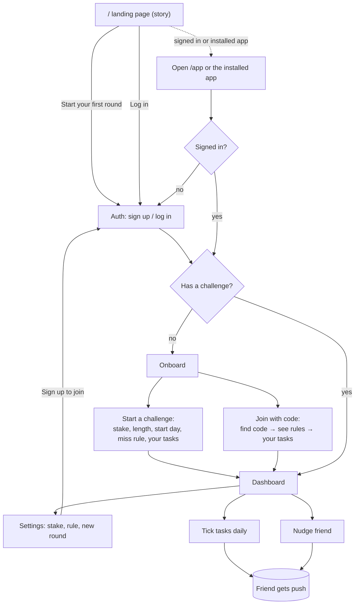
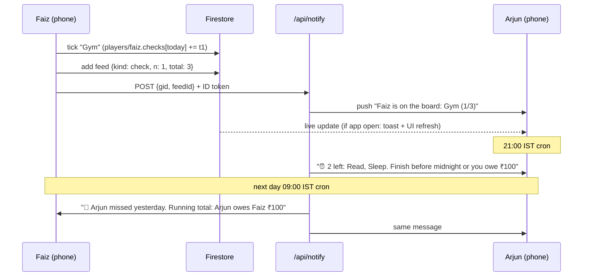

# User flow

How someone goes from a shared link to paying up. The screens map to components in `components/`.

## 1. Big picture

## 2. The landing page (`/`) and the invite card

- **Signed-out visitors** see the story: hero ("Tick it or pay for it."), then nine scenes following Aryaan and Shanayaa through one week (the pact, picking tasks, setting the stake, a live tick push, a nudge, the 9pm warning, a miss, the end of the round, the call to action), then install steps and an FAQ. Buttons: **Start your first round** → `/signup`, **I have an invite code** → `/signup?tab=join` (Onboard opens on Join with code), **Log in** → `/login`.
- **Signed-in visitors** and the **installed app** never see it: `/` forwards to `/app` before anything paints (old installs whose start URL was `/` land here too).
- **Invite links** (`/?join=K7XQ2M&from=Shanayaa`, made by Share invite) skip the story and show one card: Tik, "Shanayaa challenged you on cTicks", the code, **Sign up to join** (→ `/signup?join=K7XQ2M`) and **I have an account** (→ `/login?join=K7XQ2M`), an iPhone note (add to Home Screen first, then enter the code) and a "See how it works" link to the story. The code is also kept in `sessionStorage` (`payup.join`), so it survives sign-up even via the story. Links without `from` say "Your friend challenged you".

## 3. First-time setup: the person who creates the challenge

1. **Opens the Vercel URL** on their phone and taps **Start your first round** (the app itself is at `/app`).
   - Android: a banner offers **Install** (or ⋮ → Add to Home screen).
   - iPhone: Safari → Share → **Add to Home Screen**, then open from the icon.
2. **Auth screen** (`Auth.tsx`): name, email and password, then **Create account**.
3. **Onboard → Start a challenge** (`Onboard.tsx`):
   - Stake per missed day (default ₹100), round length (7/14/21/30), starts **Today** or **Tomorrow** (default Tomorrow).
   - What counts as a missed day: **Finish every task** (default) or **Do at least one**.
   - When someone misses: **Pay or Dare** (default) or **Money only**.
   - Their daily tasks (3 empty rows to start, up to 8).
   - **Lock it in** → creates `groups/{CODE}`, their `players/{uid}`, and a "joined" feed item.
4. **Dashboard** shows an **Invite your friend** banner with the code and **Share invite** (native share sheet / copy). The link looks like `https://<app>/?join=K7XQ2M&from=<your name>`.
5. A **Turn on notifications** banner appears. Tap it → system permission prompt → the device token is saved.

## 4. First-time setup: the friend

1. Opens the invite link and sees the invite card (the code is remembered through sign-up).
2. Installs to the home screen (required on iPhone for notifications).
3. Signs up.
4. **Onboard → Join with code** opens with the code pre-filled and looked up. It shows the stake, round length, start date, miss rule and member count.
5. Adds their tasks → **Join the challenge** → added to `members`, player doc created, and the creator gets a push: *"Arjun joined cTicks. 3 tasks locked in. Game on."*
6. Turns on notifications.

## 5. A normal day

**On the Dashboard** (`DashboardView`), top to bottom:
- **Header**: "Round 1 · Day 4 of 7 · ₹100 per miss" + ⚙ settings.
- **Banners**: install / notifications / iPhone instructions, only while something still needs doing.
- **The money**: "Arjun owes you ₹100" (lime), "You owe Arjun ₹200" (coral) or "All square", plus missed-day counts. With 3+ people it shows one row per pair.
- **Today**: your tasks as big tap targets, a progress bar, done/total and 🔥 streak. Only works while the round is active, and only for today.
- **Friend card(s)**: their tasks with filled/empty dots, their streak, and **Nudge 👀** if they still have tasks open (one nudge per 30 min per device).
- **Round grid**: a row per person, a cell per day. ✓ lime = clean, ✗ coral = missed, amber number = partial but not a miss (only under "at least one"), dashed = today, dim = before they joined.
- **Activity feed**: the last 30 events. Items that arrived since your last visit show in lime with an "N new" chip.

## 6. Ticking rules the user will hit

| Situation | What happens |
|---|---|
| Untick then re-tick the same task | The tick saves. No second push (once per task per day per device). |
| Try to tick yesterday | Not possible in the UI. The database also rejects it (rule: only today's key in IST). |
| Round hasn't started | Task buttons are disabled. The note says when ticks start counting. Tasks are still editable. |
| Day 1, nothing ticked yet | **Edit tasks** link is available. After your first tick on day 1, tasks lock until the round ends. |
| Midnight IST passes | The app's `today` refreshes within 30s. Yesterday becomes final and is scored. |

## 7. Pay or Dare: when someone misses (`Penalties.tsx`)

Only in groups whose penalty mode is Pay or Dare (the default for new groups). Full rules and every edge case: [PENALTIES_SPEC.md](PENALTIES_SPEC.md).

1. **9am, the morning after a miss:** the server creates a **penalty**. The player gets *"💸 You missed yesterday. Pay ₹100 or take a dare. Decide by 9am Sat."* (or *"That's 2 in a row… One more miss and you're out."*). Everyone else gets *"Aryaan missed yesterday. Pay or dare, their call."*
2. **Penalty card** (top of the dashboard): countdown, **Pay ₹100** or **Take a dare 🎲**. Deadlines are always 9am and are checked every morning at 9.
3. **Pay:** pay each person on UPI, tap **I paid**. Each payee gets a **Confirm payment** card: **Got it** or **Didn't get it** (back to unpaid, the payer gets a push, nobody is kicked). No answer auto-confirms at the morning check 2 days later.
4. **Dare:** the server picks a random dare from the group's deck; the card plays a short spin and lands on it. **1 reroll.** **Share dare** prefills a message for the group chat. Do it, send the video/photo to the group (WhatsApp/Instagram), tap **Done, I sent the proof**.
5. **Vote card** for everyone else: the dare, who, time left, **✅ Done / ❌ Not done** (❌ needs a reason: no proof, didn't do it, easier version, other). It fails only if more than half of the voters say ❌; not voting counts as done. It closes when everyone has voted, or at the 9am check at least 24h later.
6. **Rejected once:** **Sent it again** (same dare, new vote) or **Pay instead**, by the next 9am at least 24h away. **Rejected twice:** the dare is locked, pay by the deadline or you're out.
7. **Passed:** 🎭 on the round grid, nothing owed. **Paying is always possible** until the deadline, even mid-vote ("Rather pay?").
8. **Kicked** (ignored a penalty, didn't pay after two rejections, or 3 misses in a row): removed from the group, everyone gets *"🚪 Aryaan is out"*. The kicked player sees **You're out** (reason, what they owed, **Rejoin** once the next round starts, **Switch challenge**). Their unpaid debts stay on everyone's money card with "(out)", and they stay greyed in this round's grid. If only one person is left, the round ends and they're the last one standing.

## 8. End of a round

1. After the last day, the 9am cron sends everyone: *"🏁 Round 1 is over. Final: Arjun owes Faiz ₹200. Settle up, then start round 2 in the app."*
2. The header says "Round 1 finished · settle up" and the money card says **Final: …** with a **Start the next round** button.
3. Settings → pick length and Today/Tomorrow → **Start round 2**. Everyone gets a push. Tasks carry over and are editable again until the first tick on day 1.
4. Money is paid outside the app (UPI).

## 9. Settings sheet (`Sheets.tsx`)

- **Stake** and **miss rule** → Save. Everyone is notified. Money only: if mid-round, a warning says it re-scores the whole round. Pay or Dare: the change is queued for the next round.
- **Penalty mode**: Money only or Pay or Dare, with an explainer. Always takes effect when the next round starts.
- **Dare deck**: the dare rules, add a custom dare (blocked words are refused with the rule they break; someone else has to OK it), OK pending dares, restore reported ones (not if you reported it), report any dare (it leaves the deck at once).
- **Start round N** now goes through the server (`/api/group`), which creates any last penalties from the outgoing round first.
- **Restart with a new round** (mid-round needs a second confirm: it wipes the current round's score).
- **Switch challenge**: clears `users.groupId` and returns to Onboard (you stay a member of the old group).
- **Log out**.

## 10. Notifications (complete list)

Tapping any notification opens the app at `/app` (or focuses it if it's already open).

| Trigger | Who gets it | Example |
|---|---|---|
| First tick of the day | everyone else | "Faiz is on the board. First task done: Gym (1/3)" |
| Another tick | everyone else | "Faiz finished Read. 2/3 done today" |
| Last task done | everyone else | "Faiz cleared the day 🔥. All 3 tasks done. Your move." |
| Nudge | only the nudged person | "👀 Faiz nudged you. 2 tasks still open today. ₹100 on the line." |
| Someone joins | everyone else | "Arjun joined cTicks. 3 tasks locked in. Game on." |
| Tasks edited | everyone else | "Arjun changed their tasks. Now 4 tasks." |
| Stake/rule changed | everyone else | "Faiz changed the rules. ₹200 per missed day…" |
| New round | everyone else | "Round 2 is set. 7 days starting Mon, 30 Nov. Lock in." |
| ~9pm IST, still a miss today | that person | "⏰ Clock's ticking. 2 left: Read, Sleep… you owe ₹100. Arjun is at 3/3." |
| ~9am IST (Money only) | everyone in an active round | "💸 Arjun missed yesterday. Running total: Arjun owes Faiz ₹100." / "✅ Clean day yesterday" / "🏁 Round 1 is over" |
| Penalty created (Pay or Dare, ~9am) | the player / everyone else | "💸 You missed yesterday. Pay ₹100 or take a dare. Decide by 9am Sat." / "💸 Aryaan missed yesterday. Pay or dare, their call." |
| Dare spun / rerolled | everyone else | "🎲 Aryaan's dare: Sing the chorus of a pop song out loud, full volume." |
| Done, I sent the proof | the voters | "🎭 Aryaan says the dare is done. … Check WhatsApp and vote by 9am Tue." |
| Vote result | everyone | "✅ Aryaan's dare passed. 2 of 2 said done. Nothing owed." / "❌ Your dare didn't pass. Send the proof again or pay ₹100 by 9am Sat." |
| I paid | each payee | "💸 Aryaan says you've been paid ₹100. Confirm you got it. No answer by 9am Thu counts as yes." |
| Got it / Didn't get it | the payer | "✅ Shanayaa got your ₹100" / "🤨 Shanayaa says the ₹100 didn't arrive" |
| ~9pm, on 2 misses in a row | that person | "⏰ Miss today and you're out" |
| Kicked | everyone + the player | "🚪 Aryaan is out. Missed 3 days in a row. Back when round 2 starts." / "🚪 You're out of round 1…" |
| Round ended by elimination | everyone | "🏁 Shanayaa is the last one standing. Round 1 is over." |
| Custom dare added | everyone else | "🃏 New dare needs an OK" |
| Penalty mode switched | everyone else | "Faiz switched to Pay or Dare. Starts with round 2." |
